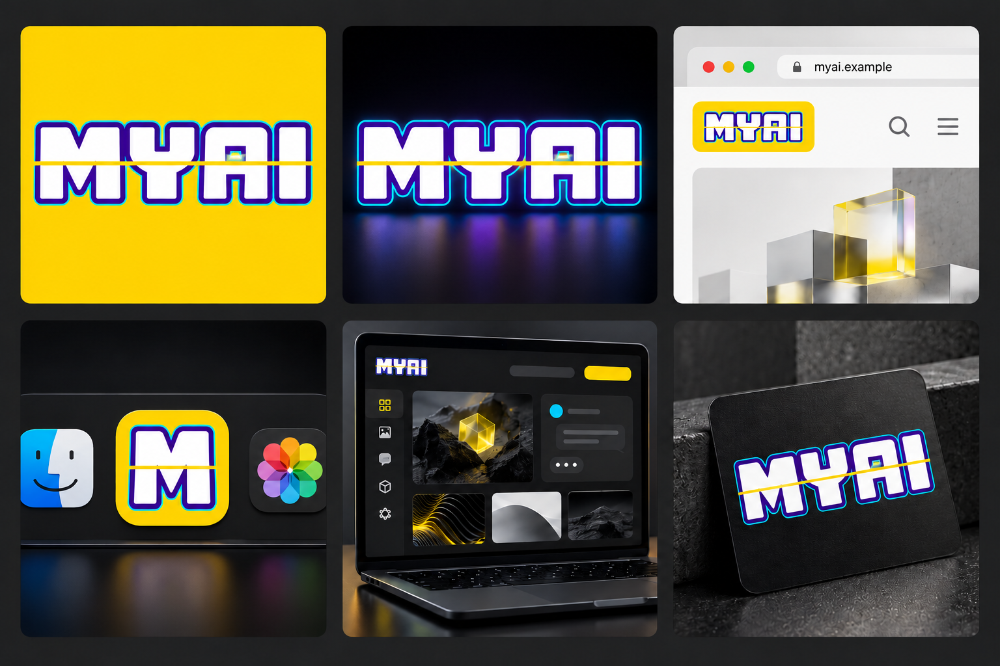

# MYAI

MYAI 将不同 AI 模型拼在一起，组成你的本地创作工作室。

[English](README.md) | **简体中文** | [🌐 全部 33 种语言](docs/i18n/README.md)

Apple Silicon Mac 本地图像、文字和实验视频工作室。

## 界面语言

图片、文字、视频及账号页面的**右上角**可选择 **33 种语言**，包括 English、Español、日本語、한국어、简体中文、繁體中文，以及巴西/欧洲葡萄牙语。浏览器记住选择，首次访问跟随浏览器语言。切换不刷新、不改写提示词、聊天正文、历史标题和已填写内容。

译文随软件保存在本地，使用时不调用在线翻译服务。新增语言包和说明文档为机器翻译，全部版本及审校状态见[语言索引](docs/i18n/README.md)。系统文件对话框及未结构化的上游错误可能保留原语言。

## 积木赛博实验室

图片、对话、实验视频和账号页面统一采用深色积木模块、凸点与拼缝、机械按键反馈、青色选中态和黄色主操作键。桌面端图片、视频、聊天的输入和操作位于左侧，生成内容位于右侧；窄屏先显示输入，再显示结果。

**⌘ K / Ctrl K** 打开工作区快捷导航；图片/视频表单内 **⌘ Enter / Ctrl Enter** 沿用正常校验后提交，禁用操作仍然禁用。视频能力说明可展开查看。33种语言、模型能力限制和账号安全检查均保留。

## 界面预览

以下展示基于本仓库已发布的页面样式。所有提示词、任务编号、时间、插画和对话均为专门制作的虚构演示内容，不含真实账号、用户图片或聊天记录。示例插画为程序绘制，不代表模型实测输出或画质承诺。

### 图片工作室

选择模型、填写提示词，查看任务与图片结果。

### 本地文字对话

在同一个工作室中进行文字交流，设置回答方式与长度。

## 全新机器部署

1. 克隆本仓库。
2. 阅读 [部署说明](README-先读我.txt)。
3. 将 [部署提示词](INSTALL-PROMPT.txt) 交给新机器上的编程助手，按本机硬件安装依赖和下载模型。

网页入口：`/edit` 图片、`/chat` 文字、`/video` 视频；默认网页端口 1235。

本仓库是经审核的发布与迁移副本，可能落后于本机开发或生产版本，不包含模型权重、虚拟环境、用户任务、聊天记录、参考图或账号配置。新机器完整部署尚未验收，不是双击即用应用。

## 文件

- `src/`：前后端、模型清单、安装及验证工具。
- `tests/`：测试；部分需要模型或运行服务。
- `requirements/`：依赖锁。
- `vendor/`：现用原生引擎源码，保留上游许可证。
- `patches/`：固定版本信息与 Apple 适配。

模型与第三方源码分别遵循上游许可证。H3/ClipProj Apple 适配属于实验功能；不要把小样通过视为所有分辨率和时长可用。

## 登录与账号管理

首次在运行服务的Mac打开 `http://127.0.0.1:1235/setup` 自行创建管理员，再从其他设备登录。管理员可新增、停用、删除账号和重置密码。详见 [账号说明](docs/accounts.md)。没有默认口令；账号文件在运行数据目录，不能上传。任务仍为共享工作室数据。

## Viggle v0.3

独立六步和九步细节模式已接入，保留旧版默认。安装及验证见 [Viggle v0.3](docs/viggle-v03.md)。模型权重需在本机单独下载。

## 品牌设计

品牌应用概念图；上方界面截图为已实现的产品。示意域名仅为占位符。
