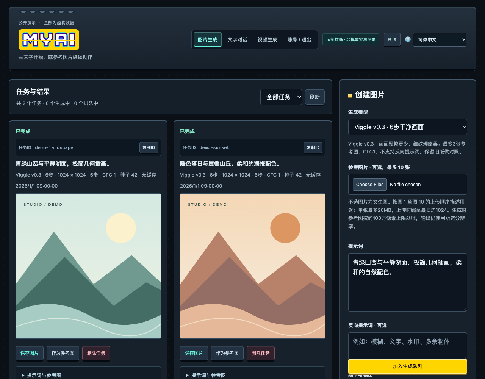
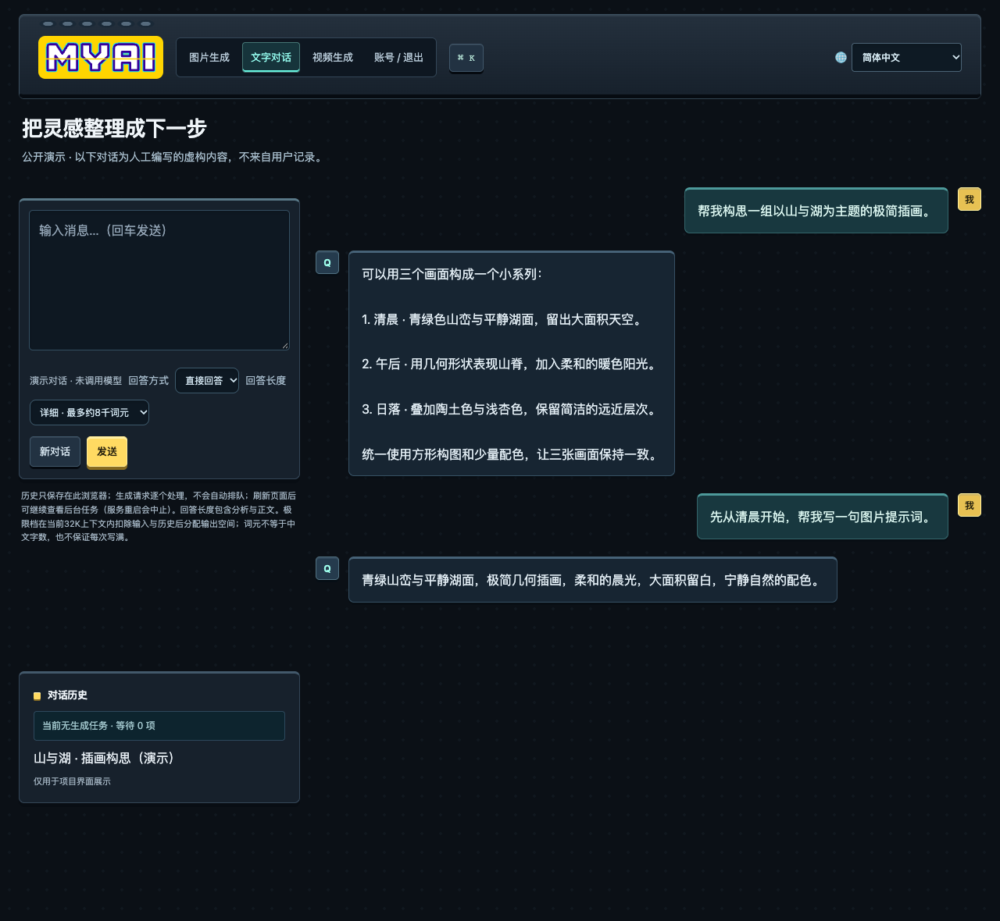

# MYAI — 本地 AI 工作室


[English](README.md) · **简体中文** · [说明文档](docs/README.zh-CN.md) · [其他语言](docs/i18n/README.md)

在 Apple Silicon Mac 上，通过同一个浏览器工作区生成图片、编辑参考图、与本地模型对话，并通过独立实验后端探索视频生成。

**本地推理 · 图像生成与编辑 · LM Studio 对话 · 私有设备访问**

MYAI 是面向愿意配置本地模型的用户的源码与迁移包。模型权重和 Python 环境需要单独安装。全新 Mac 的完整安装尚未验收，不是一键安装应用。

## 可以做什么

| 工作区 | 用途 | 条件与限制 |
| --- | --- | --- |
| 图片 `/edit` | 文生图、参考图编辑、插画及可选超分放大 | 安装对应模型和运行环境；可选项取决于模型就绪状态。 |
| 对话 `/chat` | 本地对话、回答设置及后台回复 | 需要 LM Studio、正确的模型别名及本地 API。 |
| 视频 `/video` | 实验性短视频生成 | 独立安装 H3/ComfyUI/ClipProj，遵守参数和内存限制。 |
| 账号 `/account` | 登录、修改密码和管理员操作 | 无默认密码；已登录用户共享工作室任务和媒体。 |

统一深色界面支持桌面与手机布局、键盘导航、支持模型目录，以及项目/作品分享。图片分享导出包含二维码与项目链接。当前发布版的操作见[使用指南](docs/usage.zh-CN.md)。

## 界面预览

以下界面使用虚构任务与人工准备的演示内容，**不代表模型实测画质**，不含真实用户记录。





## 从这里开始

1. 阅读[安装与首次运行](docs/getting-started.zh-CN.md)，确认硬件和安装范围。
2. 克隆仓库：

   ```sh
   git clone https://github.com/jasonhuzhensheng/local-ai-studio.git
   cd local-ai-studio
   ```

3. 按[迁移部署说明](README-先读我.txt)操作；[安装提示词](INSTALL-PROMPT.txt)可交给目标 Mac 上的编程助手，逐项核对部署。
4. 先安装一个适合本机的模型和运行环境，创建本地管理员，验证实际输出后再增加模块。

参考机器为 **Apple M2 Max、96 GB 统一内存**。这是参考配置，不是最低要求，也不保证所有流程适合更小内存的机器。下载前先核对磁盘、内存和固定依赖。

## 说明文档 — 中文 / English

| 主题 | 简体中文 | English |
| --- | --- | --- |
| 文档入口 | [目录](docs/README.zh-CN.md) | [Index](docs/README.md) |
| 安装与首次运行 | [开始使用](docs/getting-started.zh-CN.md) | [Getting started](docs/getting-started.en.md) |
| 日常使用与分享 | [使用指南](docs/usage.zh-CN.md) | [User guide](docs/usage.en.md) |
| 模型类型与限制 | [模型说明](docs/models.zh-CN.md) | [Models](docs/models.en.md) |
| 登录与共享访问 | [账号](docs/accounts.md) | [Accounts](docs/accounts.en.md) |
| Viggle 六步/九步安装 | [Viggle v0.3](docs/viggle-v03.md) | [Viggle v0.3](docs/viggle-v03.en.md) |
| 常见问题 | [故障排查](docs/troubleshooting.zh-CN.md) | [Troubleshooting](docs/troubleshooting.en.md) |

GitHub 默认以英文为入口，同时维护简体中文。应用保留 **33 种语言**选择，首次跟随浏览器语言，并记住用户选择；不翻译用户提示词或聊天正文。其他语言说明为机器翻译，可能落后于持续维护的中英文版本。

## 隐私、版本与许可

- 推理通过本机配置的引擎运行。模型下载、GitHub 链接、对外分享和可选私有网络服务各自需要网络连接；“本地”不意味着所有操作都离线。
- 这是**共享工作室**，不是隔离的多租户服务。账号不提供独立模型队列或私有媒体库；邀请其他人前请阅读[账号说明](docs/accounts.md)。
- 不提交权重、虚拟环境、用户提示词/图片/聊天、账号库、令牌或本机私有配置；仓库不包含这些内容。
- 公开发布版可能落后于开发机器。本机样张库、扩展模型及新控件不会自动进入本仓库，功能范围以[模型说明](docs/models.zh-CN.md)和当前源码为准。
- 模型与第三方组件保留各自上游许可。能够下载或被列入清单不等于获得无限制商用授权；分发组件或输出前请核对相关许可。

## 目录与反馈

`src/` 为应用与模型清单；`tests/` 为定向检查；`requirements/` 为依赖版本；`vendor/` 为原生源码；`patches/` 记录实验适配。[SHA256SUMS.txt](SHA256SUMS.txt)用于核对发布文件。

反馈问题时请提供模型 ID、Mac 芯片/内存、macOS 版本、尺寸/步数及脱敏错误。移除私有提示词、图片、账号信息及本地网络地址。
