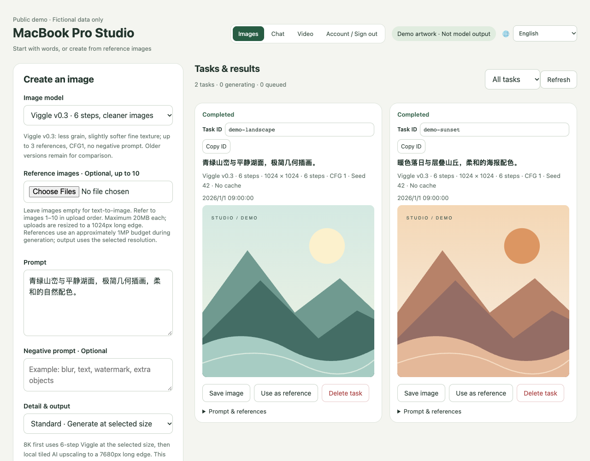
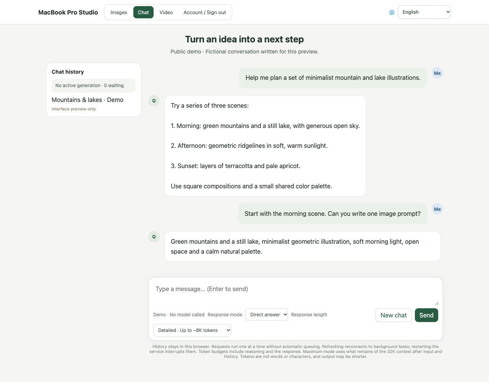

[Čeština](README.md) · [🌐 Languages](../README.md) · [English](../../../README.md) · [简体中文](../../../README.zh-CN.md)

> Tyto dokumenty jsou strojovým překladem textu veřejného projektu a ne všechny byly zkontrolovány rodilými mluvčími. Technické nejasnosti naleznete v anglickém nebo čínském zdroji. Nejsou zahrnuta žádná soukromá uživatelská data.

# MacBook Pro Studio

Místní obrazové, chatovací a experimentální video studio pro Apple Silicon Mac.

## Jazyk rozhraní

Pomocí nabídky jazyků vpravo nahoře si můžete vybrat z jazyků 33. Prohlížeč si pamatuje váš výběr. Jazykové balíčky jsou poskytovány lokálně; přepínání jazyků neodesílá obsah do online překladatelské služby. Uživatelské výzvy, konverzace a uložený obsah si zachovávají svůj původní jazyk.

## Náhledy rozhraní

Tyto náhledy používají uvolněné styly stránek. Všechny výzvy, ID úkolů, časová razítka, ilustrace a konverzace jsou fiktivní ukázkový obsah vytvořený pro toto README. Neobsahují žádné skutečné účty, obrázky uživatelů ani záznamy chatu. Ilustrace jsou nakresleny programově, ne modelovými benchmarky nebo nároky na kvalitu.

### Obrazové studio

Vyberte model, zadejte výzvu a procházejte úkoly a výsledky obrázků.

### Místní chat

Chatujte ve stejném studiu a vyberte režim odpovědi a délku.

## Nastavte si nový Mac

1. Klonujte toto úložiště.
2. Přečtěte si [průvodce nasazením](README-FIRST.txt) ([中文](../../../README-先读我.txt)).
3. Dejte [instalační výzvu](INSTALL-PROMPT.txt) ([中文](../../../INSTALL-PROMPT.txt)) kódovacímu asistentovi na cílovém Macu, aby nainstaloval závislosti a stáhl models vhodný pro daný hardware.

Stránky: `/edit` pro obrázky, `/chat` pro chat, `/video` pro video. Výchozí webový port je `1235`.

Toto úložiště je recenzovanou kopií vydání a migrace. Může zaostávat za místním rozvojem nebo výrobou. Nezahrnuje váhy modelů, virtuální prostředí, uživatelské úlohy, záznamy chatu, referenční obrázky a konfiguraci účtu. Úplná instalace na novém počítači nebyla ověřena. Toto není aplikace na jedno kliknutí.

## Obsah úložiště

- `src/`: frontend, backend, manifesty modelů, instalační a ověřovací nástroje.
- `tests/`: testy; některé vyžadují nainstalovaný models nebo spuštěné služby.
- `requirements/`: připnuté závislosti.
- `vendor/`: nativní zdroj motoru se zachováním upstream licencí.
- `patches/`: připnuté verze a úpravy Apple.

Modely a zdroje třetích stran si ponechávají své upstream licence. H3/ClipProj Podpora Apple je experimentální. Úspěšný krátký vzorek nezakládá podporu pro každé rozlišení nebo trvání.

## Přihlášení a účty

Na Macu, na kterém je spuštěna služba, otevřete `http://127.0.0.1:1235/setup` a vytvořte prvního správce a poté se přihlaste z dalších zařízení. Správci mohou vytvářet, deaktivovat a mazat účty a resetovat hesla. Viz [dokumentace účtu](accounts.md) ([中文](../../accounts.md)). Neexistuje žádné výchozí heslo. Soubory účtů zůstávají v datovém adresáři runtime a nesmí být nahrány. Úkoly zůstávají sdílenými daty studia.

## Viggle v0.3

K dispozici jsou samostatné šestikrokové a devítikrokové režimy detailů, přičemž předchozí výchozí nastavení je zachováno. Viz [instalace a ověření](viggle-v03.md) ([中文](../../viggle-v03.md)). Stáhněte si modelové závaží samostatně na cílový Mac.
