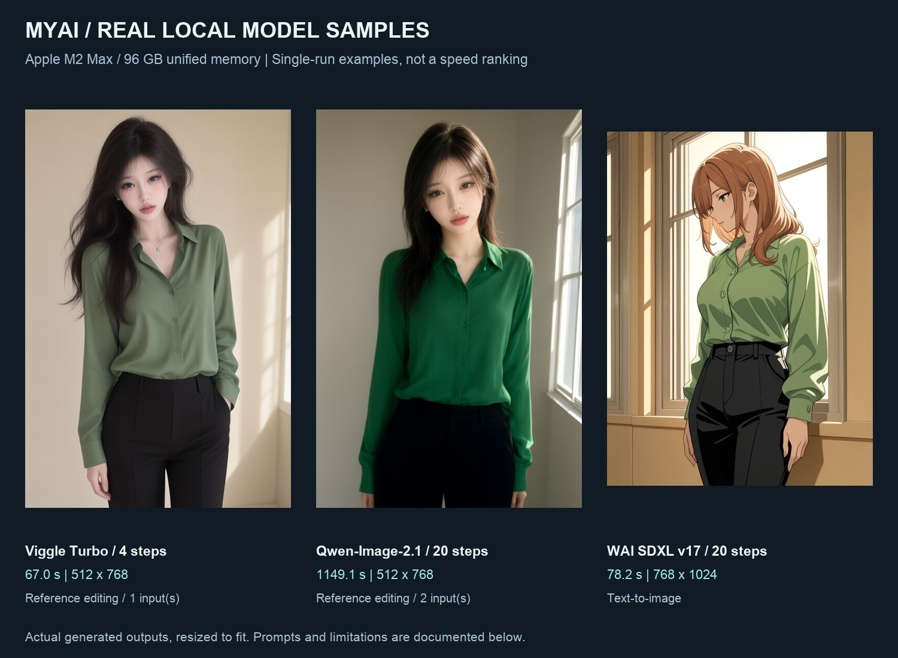
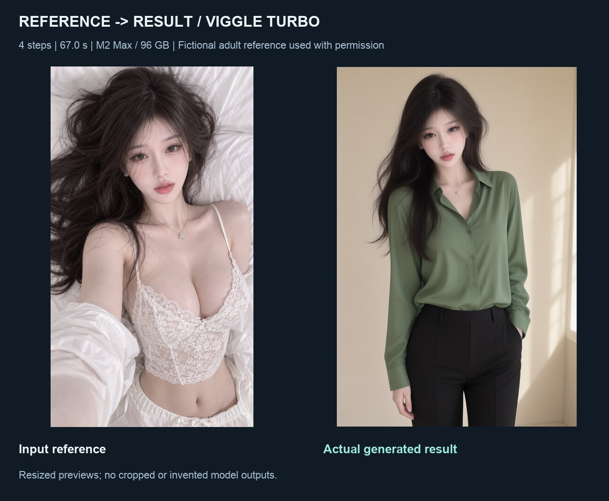
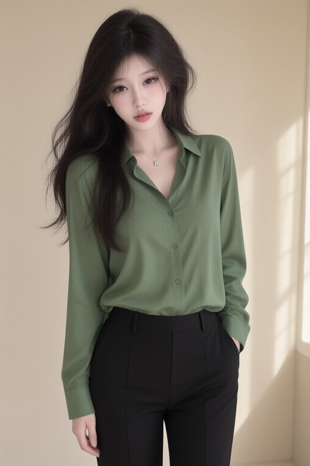
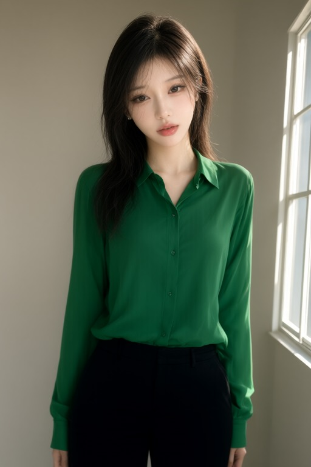
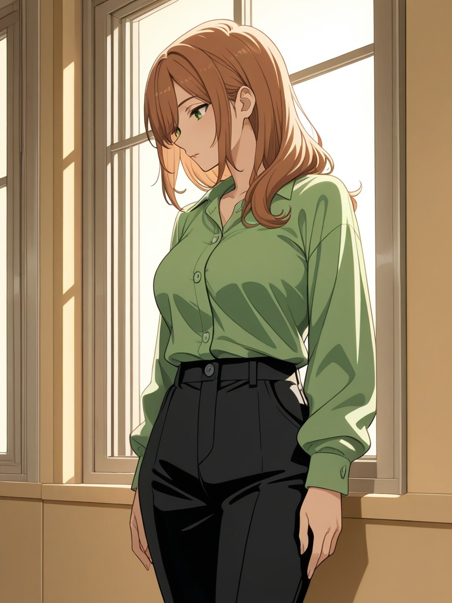

# Real model samples

[English](model-samples.en.md) · [简体中文](model-samples.zh-CN.md)

These outputs were generated on the local reference machine. They are not UI mockups. The fictional adult references were supplied with permission to publish. Images are resized JPEG previews, not native-resolution files.



**Machine:** Apple M2 Max, 12 CPU cores, 96 GB unified memory, macOS 27.0.1.

Times measure a single task from start to finish, including loading and postprocessing inside that task, excluding queue time and failed attempts. Different sizes, steps and input conditions are not a controlled performance comparison.



## viggle-qwen-image-2.1-4step

67.0 s · 512 × 768 · 4 steps · seed 42

Inputs: [Reference 1](images/model-samples/reference-2.jpg)



### Prompt (verbatim)

```text
Create a neutral fashion catalog portrait of the same fictional adult woman in the reference image. She is standing upright, wearing an opaque green long-sleeved buttoned shirt and black trousers. Waist-up composition, simple beige room, warm natural window light, relaxed neutral expression. Preserve her face and long dark hair. Fully clothed, no lingerie, no text, no watermark.
```

### Negative prompt

None supplied.

## qwen-image-2.1

1149.1 s · 512 × 768 · 20 steps · seed 42

Inputs: [Reference 1](images/model-samples/reference-1.jpg), [Reference 2](images/model-samples/reference-2.jpg)



### Prompt (verbatim)

```text
使用图二的人物外观，参考图一的窗边构图和自然侧光，生成绿色长袖衬衫、黑色长裤的普通着装人像。保持自然比例与一致光照，背景简洁。不添加文字、水印或无关物体。
```

### Negative prompt

None supplied.

## wai-illustrious-v17

78.2 s · 768 × 1024 · 20 steps · seed 42

Inputs: Text only; no reference image.



### Prompt (verbatim)

```text
masterpiece, best quality, anime illustration, adult woman, green long-sleeved buttoned shirt, black trousers, standing by a window, waist-up, warm natural side lighting, beige room, detailed hair, fully clothed
```

### Negative prompt

low quality, blurry, bad anatomy, text, watermark, lingerie, nudity

## Interpretation and scope

Viggle demonstrates a clothing/scene edit, not a guarantee of exact identity preservation. Qwen combines two references and retains soft details. WAI produces illustration, not photorealistic reconstruction. These three samples passed this session’s visual review; that does not establish general quality or all model capabilities. The complete local session included limited and rejected outputs, which are not presented here as successes.

Publishing these samples does not update the repository’s runtime or install models. See [model scope](models.en.md). Machine-readable prompts, dimensions and source-output hashes: [samples.json](images/model-samples/samples.json).
